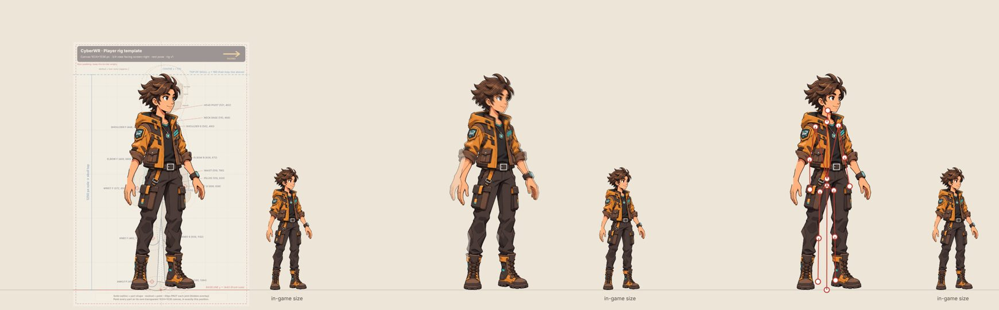
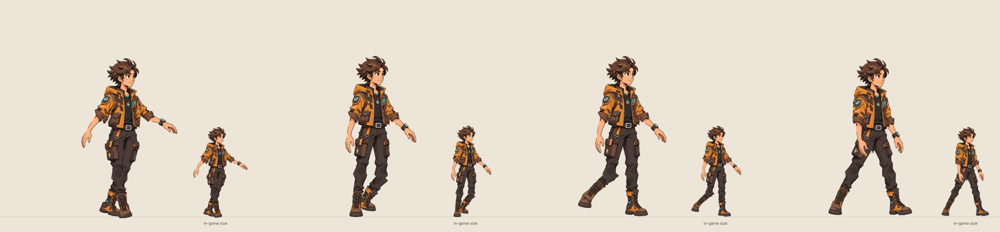
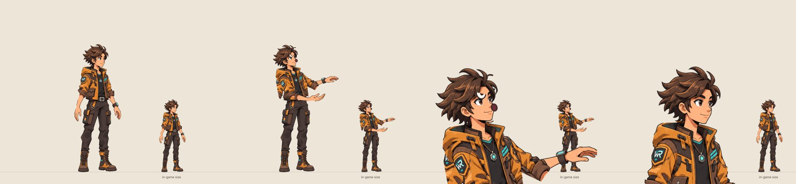
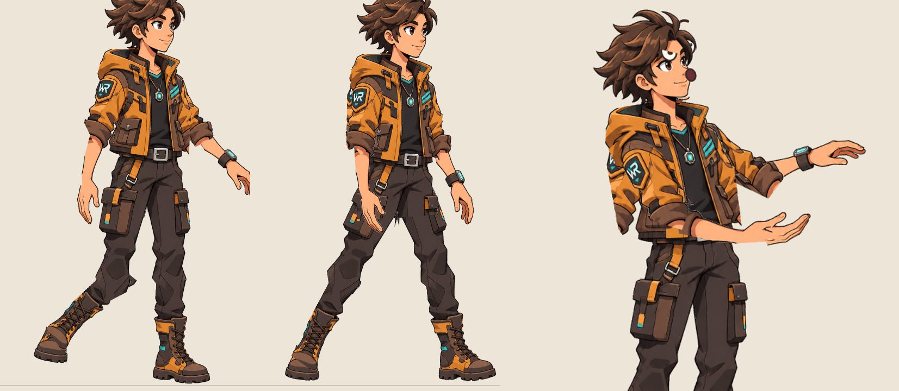
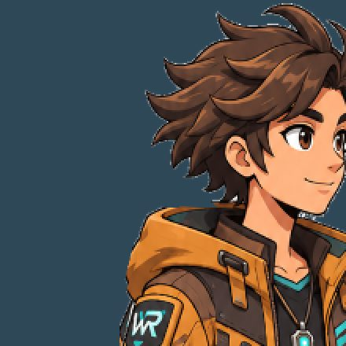
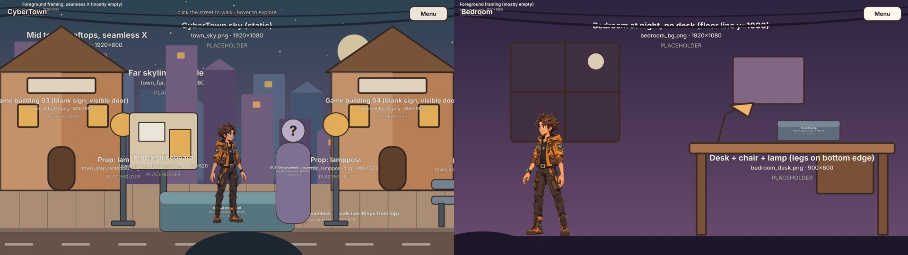

# Rig test v1: review (`CyberWR_Rig_Test.zip`)

> **Outcome:** Option B was chosen. The rig was refitted to the approved design as
> [template v1.1](../../rig-template/README.md). This package is kept as a design reference only;
> its part files are not reused.

**Status: DRAFT, not accepted.** The art is not committed to the repository; it was validated locally
only. Reviewed on 2026-11-23 against rig template v1 (`docs/rig-template/`).

## Summary

| Check | Result |
|---|---|
| File names / folder | ✅ All 28 expected files present, correctly named |
| Format / canvas | ✅ All PNG RGBA, 1024×1536 |
| Padding | ✅ Nothing inside the 16 px border |
| Rest-pose assembly | ✅ The parts reassemble exactly into `player_ref_o01.png` |
| Style at game size | ✅ Reads clearly at 0.34 scale, and the style holds up in motion |
| Expression states | ❌ 5 files are completely empty; `smile` is a copy of `neutral` |
| Face separation | ❌ Eyes, brows and mouth are baked into `player_skin_s01_head.png` |
| Hair split | ❌ Every `hair_front` pixel is duplicated inside `hair_back` |
| Hidden joint overlap | ❌ Parts are clipped from a flat image, so cut edges show at elbows, knees, waist and shoulders when they rotate |
| Shoulder split | ❌ The upper sleeves (incl. the WR badge) are part of `torso`, so raised arms show a doubled sleeve |
| Feet | ❌ The front boot points at the viewer/left, so the trailing foot points backwards in the walk |
| Pose vs template | ⚠️ Arms ~25–30° from the body (template ~15°); torso close to front-on (template 3/4) |
| Edges | ⚠️ Light-grey/white fringe on semi-transparent edges (visible on dark scenes) |

Validator: `23 delivered · 5 errors · 23 warnings` (errors = the 5 empty state files).

*Left: template overlay. Middle: reference onion-skin (identical at rest). Right: bones. The character
matches the template's height, head and legs; the arms sit outside the template's arm path.*

*Contact, passing, push-off, swing. The walk reads as a walk, even at in-game size.*

*Surprise and blink fail because the face features are baked in: the placeholder states draw on top
of the painted eyes and mouth ("clown face"), and the eyes never close.*

*Close-ups: notches at knees/elbows from straight cut edges, doubled sleeve and badge when the arm
rises, ragged jacket hem at the waist, trailing boot pointing backwards.*

*Light fringe around hair and jacket on a dark backdrop.*

## Measured joint positions (art vs. rig template v1)

Measured from where adjacent parts meet. Positions are canvas px (1024×1536).

| Joint | Template | Art (measured) | Offset |
|---|---|---|---|
| Head pivot | (521, 402) | (525, 399) | ✅ 5 px |
| Neck base | (515, 468) | (524, 441) | 28 px |
| Waist | (510, 795) | (530, 754) | 45 px (jacket ends at y≈776) |
| Hip F / Hip B | (470, 870) / (550, 862) | (466, 870) / (578, 861) | ✅ 4 px / 28 px |
| Knee F / Knee B | (462, 1140) / (556, 1132) | (416, 1136) / (581, 1123) | 46 px / 26 px |
| Ankle F / Ankle B | (458, 1392) / (560, 1384) | (391, 1376) / (594, 1367) | 68 px / 38 px |
| Elbow F / Elbow B | (400, 680) / (626, 672) | (372, 670) / (671, 676) | 29 px / 45 px |
| Wrist F / Wrist B | (372, 850) / (650, 838) | (297, 829) / (721, 821) | **75 px / 71 px** |

## Correction list for ChatGPT

Blocking items first. Zones are canvas px on the 1024×1536 canvas. Joint coordinates are from
**template v1**; if Option B is chosen (see the end), use the v1.1 coordinates instead. The
corrections themselves stay the same.

### 1. Paint the missing expression states (blocking)
These files are **completely transparent**:
`player_eyes_e01_half.png`, `player_eyes_e01_closed.png`, `player_eyes_e01_wide.png`,
`player_brows_b01_raised.png`, `player_mouth_m01_surprised.png`.
- **Location:** paint each one at exactly the same position as the delivered open/neutral version.
  - Eyes: inside x 528–620, y 289–350.
  - Brows: inside x 527–628, y 263–314.
  - Mouth: inside x 544–594, y 356–402.
  - These positions are accepted as delivered. They differ slightly from the v1 guide, and that's fine.
- `half`: upper lids halfway down. `closed`: lash lines only. `wide`: larger whites, smaller irises.
  `raised`: brows lifted ~10–14 px and more arched. `surprised`: small open "o" mouth.
- `player_mouth_m01_smile.png` is **byte-identical** to `player_mouth_m01_neutral.png`. The current
  mouth is a slight smile, so either keep it as `smile` and paint a relaxed closed mouth for
  `neutral`, or paint a clearly bigger smile for `smile`.

### 2. Skin-only head (blocking)
`player_skin_s01_head.png` still contains the eyes, brows and mouth. Repaint it with **smooth skin
under all feature zones** (x 520–630, y 255–405), keeping ears, nose, jaw line and cel shading. The
feature files then sit on top. Otherwise blink and surprise can't work (see screenshot 3).

### 3. Separate the hair layers (blocking)
`player_hair_h01_back.png` contains the whole hairstyle, including everything in `hair_front`.
- `hair_back`: only the hair **behind** the head (back of the skull, nape, strands behind the ear and
  neck). Fill the skull area that the front hair covers with hair so no skin gaps appear when the head
  tilts.
- `hair_front`: fringe and top locks that overlap the face/forehead only.
- No visible pixel should be painted in both files.

### 4. Split sleeves from the torso (blocking)
`player_outfit_o01_torso.png` includes the upper sleeves (front sleeve with the WR badge, back
sleeve). When an arm rotates, a second copy of the sleeve stays behind (screenshot 4, right).
- The torso ends at the shoulder seams; the **whole sleeve from the shoulder cap down** belongs to
  `player_outfit_o01_upperarm_front.png` / `_back.png`.
- Under the shoulders, paint the torso's jacket as a **rounded shoulder socket** so the jacket, not
  the background, shows when the arm lifts.
- Shoulder pivots: **front (448, 495), back (582, 490)**. This applies if you redraw to template v1;
  see the "Which pose?" decision below.

### 5. Paint hidden overlap at every joint (blocking)
Every limb part currently stops at a straight cut line, which shows as a notch when it rotates.
Extend each part ~30 px past its joint with a rounded end, painting the hidden area too:

| File | Joint to extend past |
|---|---|
| `player_outfit_o01_upperarm_front.png` | shoulder F (448, 495) and elbow F (400, 680) |
| `player_outfit_o01_forearm_front.png` | elbow F (400, 680): the rolled cuff must cover the elbow at ±40° |
| `player_skin_s01_hand_front.png` | wrist F (372, 850): paint the wrist up under the cuff/watch |
| `player_outfit_o01_upperarm_back.png`, `…_forearm_back.png`, `player_skin_s01_hand_back.png` | shoulder B (582, 490), elbow B (626, 672), wrist B (650, 838) |
| `player_outfit_o01_thigh_front.png` / `…_thigh_back.png` | hip F (470, 870) / hip B (550, 862), painted up under the jacket and belt |
| `player_outfit_o01_shin_front.png` / `…_shin_back.png` | knee F (462, 1140) / knee B (556, 1132), with a rounded knee on both parts |
| `player_outfit_o01_foot_front.png` / `…_foot_back.png` | ankle F (458, 1392) / ankle B (560, 1384): paint the boot shaft up into the trouser leg |
| `player_outfit_o01_torso.png` | waist (510, 795): the full jacket hem hangs over the belt (it currently ends at y≈776 with a ragged cut) |
| `player_outfit_o01_pelvis.png` | waist (510, 795): paint belt and trouser top up to y≈765 under the jacket |
| `player_skin_s01_neck.png` | neck base (515, 468): extend down under the collar to y≈500 |

### 6. Boots must face screen-right (blocking for walk)
The front boot (`player_outfit_o01_foot_front.png`) points toward the viewer and slightly left, so in
the walk the trailing foot points backwards (screenshot 4).
- Draw **both boots in 3/4 view pointing right**, with the toe toward +x.
- Front boot: sole on **y = 1440**, ankle (458, 1392), toe reaching about x 550.
- Back boot: sole on y ≈ 1432, ankle (560, 1384), toe about x 650.

### 7. Remove the white edge fringe (should fix)
Semi-transparent edge pixels are light grey (average RGB ≈ 202,199,199; 44 % near-white on the torso).
The edges were matted on white. Export with **straight alpha and no background matte**, or defringe
before export. It affects hair (both layers), torso, pelvis, all sleeves, shins, back foot, back hand
and the reference.

### 8. Pose (decision needed)
The arms hang ~25–30° from the body (hands at x 252–326 and 696–772), and the torso is close to
front-on (shoulders span x ≈ 340–700). The template expects ~15° arms and a 3/4 torso. This is the
only item where we choose between redrawing the art and adjusting the rig; see the decision below.

## Which pose? (decision)

The body proportions are close to the template already. Head, hips and leg length match within a few
px; the arms and the turn of the torso are what differ. There are two ways to close the gap:

- **Option A: redraw to template v1.** Arms come in to ~15° (wrists at (372, 850) / (650, 838)),
  the torso turns to 3/4 (shoulders at x 448 / 582), and the knees and ankles move to the template
  positions. This is the most redrawing.
- **Option B (recommended): keep this approved body and refit the rig.** Claude publishes rig
  template **v1.1** with joints measured on this character. Animations bring the arms in a little in
  code. ChatGPT then only does the separation work (items 1–7). This is less redrawing, and the
  approved design stays as it is.

Items 1–7 are needed in either case.
