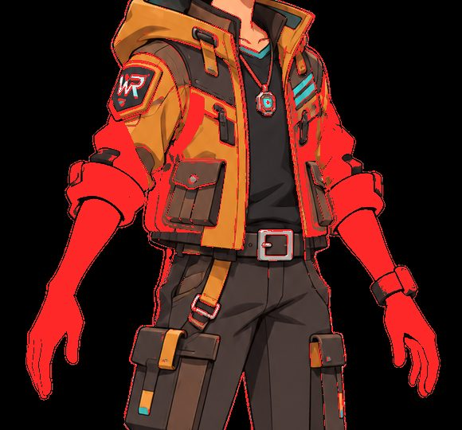
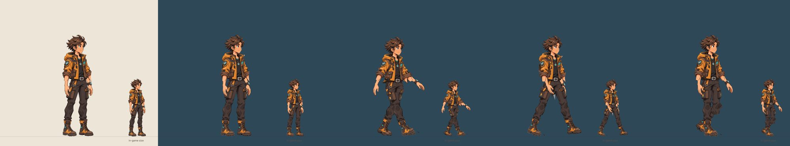
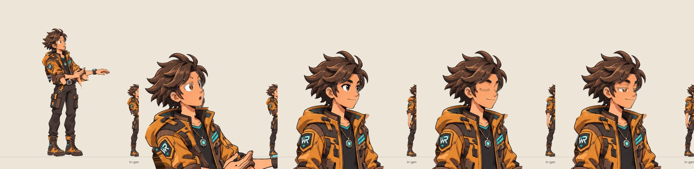

# Rig test v2: review (ChatGPT edits → automatic cut)

**Status: NOT YET ACCEPTED. One re-edit needed (E09b).** The draft parts are kept out of the
repository until they pass.

## What was delivered

10 full-image edits from the edit kit (`edit_01_boot.png` … `edit_10_belt.png`), downloaded from the
shared Drive folder.

| Check | Result |
|---|---|
| Framing | ✅ Character in exactly the same place in all 10 (0–1 px shift, corrected automatically) |
| Size / format | ⚠️ RGB on a black background, not transparent; 4 files 1 px short (1024×1535). Handled by the cutter. |
| Re-rendering | ⚠️ ChatGPT redrew 6–14 % of the character outside the selected areas (line wobble). Harmless: the cutter takes only the selected areas from each edit. |
| E01 boot | ✅ Front boot now points right, matching the other boot |
| E02 blank face | ✅ Clean skin, nose and ears kept |
| E03–E08 expressions | ✅ Half, closed and wide eyes; raised brows; neutral and surprised mouths |
| E09 no arms | ⚠️ Forearms and lower sleeves removed, but the **sleeve tops and the WR badge were kept as part of the jacket** |
| E10 belt | ✅ Full belt and waistband visible |

## Cut and validation

`tools/rig_cutter/cut_parts.py` produced all 28 parts. Validator: **28 delivered, 0 errors, 0 warnings**
(every must-paint point covered, all expression states distinct and non-empty, no double-drawn hair,
no features in the head, no edge fringe).

## Rig Lab

*Rest on light and dark backgrounds, then the walk cycle (contact, push-off, swing). Clean.*

*Surprise; face zoom: surprise, neutral, blink, half-blink. All face states work.*

| Test | Result |
|---|---|
| Rest pose | ✅ Matches the design; fringe cleaned |
| Idle / blink | ✅ |
| Walk | ✅ Feet planted, both boots point the right way |
| Surprise | ⚠️ When the arms lift, a **second WR badge** and smeared jacket strokes show at the front shoulder (from E09's kept sleeve tops) |

## Remaining action

- **E09b:** upload `edit_09_no_arms.png`, select both shoulder tops (see
  `docs/edit-kit/E09b_shoulders_SELECT.png`) and use the E09b prompt in `docs/edit-kit/PROMPTS.md`.
  Then rerun the cutter with `edit_09b_shoulders.png` in place of E09, validate, and re-test surprise.
